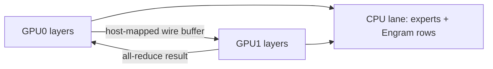

<a id="readme-top"></a>

<div align="center">

<h1 align="center">Hy4-flash Uncensored на 2×RTX 3090 без P2P</h1>

<p align="center">
  Форк <a href="https://github.com/alesha-pro/project-maya/tree/hy4-flash">alesha-pro/project-maya</a>: 220B MoE Tencent Hy4-flash, 262144 контекста, vision, MTP и abliteration-вектор на двух картах, даже если чипсет не умеет P2P.
  <br />
  <br />
  <a href="https://github.com/alesha-pro/project-maya/pull/2"><strong>Pull Request »</strong></a> ·
  <a href="https://huggingface.co/alesha-pro/Hy4-flash-Uncensored-GGUF"><strong>Веса на Hugging Face</strong></a> ·
  <a href="docs/HY4-FLASH.md"><strong>Upstream-гид</strong></a>
</p>

<p align="center">
  
  
  
  
  
</p>

</div>

<details open>
<summary><b>📑 Содержание</b></summary>

- [📖 О проекте](#-о-проекте)
- [🧩 Что даёт патч](#-что-даёт-патч)
- [⚙️ Как работает транспорт](#-как-работает-транспорт)
- [🚀 Быстрый старт](#-быстрый-старт)
- [📊 Замеры](#-замеры)
- [⚠️ Ограничения](#-ограничения)
- [🔗 Ссылки](#-ссылки)
- [🙏 Благодарности и лицензия](#-благодарности-и-лицензия)

</details>

## 📖 О проекте

> **Две RTX 3090 на плате, где P2P не поддерживается, всё равно дают tensor parallel: обмен активациями идёт через host-mapped память по PCIe, а не через peer-доступ к VRAM.**

**Проверено на:** Ubuntu, 2×RTX 3090, Xeon E5-2696 v4, 126 ГБ DDR4-2400, IQ2_XXS trunk, 262144 контекста, Engram на NVMe, thinking off.

Это форк `alesha-pro/project-maya` (ветка `hy4-flash`) с локальным патчем. Upstream требует P2P для двух карт и на чипсетах с `CNS (Chipset not supported)` падает с `no P2P between GPUs 0 and 1`. Патч оставляет машины с P2P на прежнем device-пути, а без P2P переключает обмен на host-mapped буферы. PR: [#2](https://github.com/alesha-pro/project-maya/pull/2).

## 🧩 Что даёт патч

| Возможность | Состояние |
|---|---|
| 2 GPU без P2P (CNS), tensor parallel | работает |
| P2P-путь на машинах автора | сохранён, но здесь не перепроверялся |
| Uncensored-вектор (`HY4F_ABLATE`) | включён в конфиге |
| Engram `O_DIRECT` на 2 GPU | работает, таблица 63 ГБ остаётся на NVMe |
| 262144 контекста | работает |
| Сборка nvcc 12.4 + gcc 12 | исправлена: `xmmintrin.h` вместо `immintrin.h` |

## ⚙️ Как работает транспорт

При загрузке движок проверяет `cudaDeviceCanAccessPeer` для каждой пары карт. Если P2P есть, остаются device-буферы, `cudaDeviceEnablePeerAccess` и peer-копии. Если нет, буферы и флаги обмена (`all-reduce`, attention combine, batch, decode) выделяются через `cudaHostAlloc(Mapped|Portable)`, и обе карты читают их по PCIe через UVA. Ядра уже используют `__threadfence_system()` и `volatile`-флаги, поэтому менять их не пришлось. Копии KV-мирроров при смене префикса идут через pinned host buffer.



## 🚀 Быстрый старт

```bash
git clone -b hy4-flash https://github.com/Bezooom/project-maya
cd project-maya
git checkout bezooom/readme

cmake -S . -B build -G Ninja -DCMAKE_BUILD_TYPE=Release -DSTRATA_ENABLE_CUDA=ON \
  -DCMAKE_CUDA_ARCHITECTURES=86 -DCMAKE_CUDA_COMPILER=/usr/bin/nvcc \
  -DCMAKE_C_COMPILER=gcc-12 -DCMAKE_CXX_COMPILER=g++-12 \
  -DCMAKE_CUDA_HOST_COMPILER=g++-12 -DSTRATA_BUILD_TESTS=OFF -DGGML_NATIVE=OFF
cmake --build build -j 22 --target maya-hy4f
```

Веса: IQ2_XXS набор (trunk 51 ГБ + Engram 63 ГБ), `mmproj`, вектор и `routing-profile.txt` из [alesha-pro/Hy4-flash-Uncensored-GGUF](https://huggingface.co/alesha-pro/Hy4-flash-Uncensored-GGUF). Конфиг: `docs/hy4-flash/hy4f-2gpu-iq2-nvme.json`, порт 18000.

На этом стенде запуск и остановка обёрнуты в `~/start_hyf.sh` и `~/stop_ai.sh`; чат открывается на `http://127.0.0.1:18001/`.

## 📊 Замеры

2×RTX 3090, Xeon E5-2696 v4, 126 ГБ, IQ2_XXS, 262144 контекста, Engram на NVMe, thinking off:

| Прогон | tok/s |
|---|---:|
| первый ответ | 54.6 до 65.2 |
| прогретый | 79.5 |
| прогретый | 87.3 |
| прогретый | 95.3 |
| прогретый | 100.0 |

RSS около 61 ГиБ, VmSwap движка 344 МБ. Для сравнения: тот же бинарник на одной карте даёт 26–40 tok/s.

## ⚠️ Ограничения

- Протестированы только две карты и набор IQ2_XXS. Четыре GPU и Q3_K не проверялись.
- Host-транспорт добавляет задержку PCIe; на машине с рабочим P2P должен оставаться device-путь.
- Длинный prefill (десятки тысяч токенов) не замерялся.
- Engram direct читают оба шарда; общий кэш строк гасит повторное чтение.
- Это локальный патч, не upstream; поведение после merge может отличаться.

## 🔗 Ссылки

- PR: https://github.com/alesha-pro/project-maya/pull/2
- Upstream-гид: [docs/HY4-FLASH.md](docs/HY4-FLASH.md)
- Веса: https://huggingface.co/alesha-pro/Hy4-flash-Uncensored-GGUF
- Патч: `git diff 7d04c8d^..7d04c8d`

## 🙏 Благодарности и лицензия

Hy4-flash: Tencent. Q3_K: AngelSlim. IQ2 experts: AtomicChat. Движок и гид: [alesha-pro/project-maya](https://github.com/alesha-pro/project-maya), выросший из [Strata](https://github.com/Niko1221/Strata). Лицензия модели: [Tencent Hy License 1.0](https://huggingface.co/alesha-pro/Hy4-flash-Uncensored-GGUF/blob/main/LICENSE).
